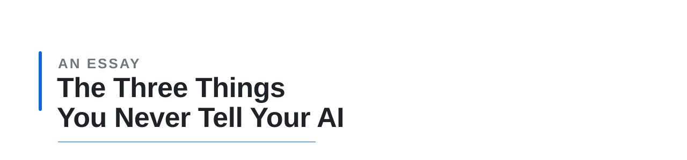

  
  
  

  <picture>
    <source media="(prefers-color-scheme: dark)" srcset="../assets/banner-dark.svg">
    
  </picture>

  
  

> 这篇讲的是话本身的结构。跟 AI 一起干活的时候，你的话里缺了什么，它就会自己补一个——补对了你省事，补错了你返工。开头那件事它补对了；后面大部分内容，讲的是补错的时候怎么办。不涉及具体工具的用法，那些换个环境就得重写。
>
> **TL;DR** — **要什么、别碰什么、现在能不能动手**，这三样人以为对方知道，所以从来不说。第一样漏了，你返工；第二样漏了，它会把你想留的东西一起「优化」掉；第三样漏了，不能撤回的东西已经没了。

目录

- [你的话里有三样它猜不到](#你的话里有三样它猜不到)
- [要什么：给它一个能验收的句子](#要什么给它一个能验收的句子)
- [别碰什么：两件事，一件是拦住，一件是保住](#别碰什么两件事一件是拦住一件是保住)
- [能不能动手：做不做，和怎么做](#能不能动手做不做和怎么做)
- [什么时候说，比说什么重要](#什么时候说比说什么重要)
- [一条超出范围的话](#一条超出范围的话)
- [它说做完了，你怎么知道](#它说做完了你怎么知道)
- [最后](#最后)

前一阵我让 AI 把一个旧项目的文件夹删掉。放了两个月没动，我不想再管了。

它没立刻动手。先把整个文件夹打包备份了一份，连旧版本一起，做完才回来问要不要继续。中途弹回来一条权限提示，它去查了，回来说不是权限问题，是缺一项授权；我说那你去办，它自己把流程走完了。删完又核对了一次，确认那个文件夹真的不在了。

这三步我都没有要求过。不过后面讲的全是它补错的时候——它补对的时候，你根本不会注意到。

## 你的话里有三样它猜不到

你跟同事说「改一下结尾」，同事知道「其他地方别动」，这是常识，不用说出来。你跟 AI 说同一句话，它没有这个常识——它只知道你说了什么，不知道你没说什么。而你没说的部分，它不会留白，会自己填一个。填得还挺合理，所以你当场看不出来，等结果出来了才发现偏了。

人和人共事的时候，有三样东西大多数话都不用说出口：

**要什么。别碰什么。现在能不能动手。**

人靠默契补，AI 靠猜。猜对了你不会夸它，猜错了你只会说「不对」。这三样里最贵的是最后一样——前面两样错了还能改，最后那样错了，东西已经没了。

这三样是三个观察角度，不是三种互不重叠的任务。同一句指令可以同时涉及三样：「不要直接删，先备份，等我确认」——禁止项、手段、授权时机，一句里全有。分开讲，是因为它们对应不同的失败方式，补救办法也不一样。

## 要什么：给它一个能验收的句子

最常见的失败，是一开口就说了个任务名。

「帮我写个爬虫」——爬什么、爬到什么程度算完、结果放哪儿，一个字没有。它只能自己画一条终点线，画完交给你，你说不对。

「写个爬虫」描述的是动作，「每周一早上邮箱里有一份整理好的清单」描述的是结果。前者没法验收，后者每个词都能被检查。

改起来不难，就是把「我要做什么」换成「什么状态算做完」：

- 不要：帮我整理一下这些文件
- 要：这些文件按月份分到十二个文件夹里，重名的保留最新那份
- 不要：优化一下这段代码
- 要：这个函数里重复读文件的四次调用合并成一次，行为不变

对照着看，后一条里什么算做完是一目了然的。

你说不清什么算完成，可能有两种来源：一是目标本身还没想清楚；二是目标其实清楚，只是还没被翻译成能检查的条件。第二种更常见，也更可惜——你脑子里有标准，只是那个标准还是「看着舒服」「用起来顺」这种形态。无论哪一种，返工的成本最后都落在你身上。

还有第三种，得单独说：有些目标本来就依赖感觉，比如文案的语气、排版的疏密。这类东西没法写成条件，只能靠对比——给它两版，说哪版更接近。这不算没说清，只是验收方式换了。

有一种情况例外：你还没想清楚要什么，只想先看看有什么可能。这时候说「你先翻翻这些文件，看看有什么」比硬凑一个目标强。区别在于——你要的是一个决定，还是一个东西。

## 别碰什么：两件事，一件是拦住，一件是保住

这一样最容易被说漏，因为它其实是两件事，而人对这两件事的默认程度不一样。

**第一件是拦住**：有一类事你不想让它做。对着一个已有系统改东西的时候，这个最常见——不要动上线配置、不要改数据库、不要碰那个我正在编辑的文件。这类事不说，它可能顺手就做了。

**第二件是保住**：它改的范围内，有些东西你不希望动。不是不能碰，是碰了你就得重来。

两件事的差别，用一句指令就能看出来：

> 只改测试环境，线上一个字都别动。（拦住）
>
> 只改结尾那两段，中间那段我喜欢，别动。（保住）

第二句不说的话会发生什么，我遇到过很多次：你让它只改最后一段，它还回来的时候，最后一段确实改了，顺便把全文标点统一成半角，删了几处「的」，句子也捋顺了一点——改得都没错，但你要的那种停顿感没了。

你说，其他地方我没让你动吧。它说，好的。然后又动了一遍。

「只改这里」在它听来大概是「重点是这里」。要它真的不动，得把不动也说出来。半句话，省掉一整轮。

保住这一件比拦住更难说，因为人只在出问题的时候开口。我回想过自己平时怎么给反馈：绝大多数是「不行」「再改」「不对」，很少有一句「这段就这样，别动」。这意味着它收到的信息是偏的——它不知道哪些部分是你没吭声但其实满意的。

所以第二版比第一版差的时候，你说「不行」，它第三版会把第二版里那点好东西一起删掉。它是在按你给的信息猜，而你给的信息本来就只有一半。

后来我改了一点：否定的时候带上方向。「不行」和「不行，回到第一版那个思路」——前者要它自己猜哪里不行，后者直接给了落点。

至于怎么判断是这一样出了问题，判据要严一点：**同一处地方反复改，本身不说明原因是你没说清。** 也可能你的要求自相矛盾，也可能它做不到。能区分的只有一种情况：当你说出「这段留着」之后，它还改不改。还改，那才轮到这一样。

这条判据的能力边界也要说清：它只能告诉你「保护边界有没有被遵守」，区分不了「能力不够」和「上下文丢了」。别让它承担超过这个的诊断任务。

一次性的事、草稿、原型不用管这些。那种东西本来就该推翻重做，分析哪部分该留反而更贵。

## 能不能动手：做不做，和怎么做

「这个功能不错，加上吧。」

这句话在你这儿是方向，在它那儿是命令。但真正的问题不在这一句，在于它其实是两个问题被压成了一条：

**做不做，和怎么做。**

做不做归你。不能撤回的事、涉及钱和对外的事，这个回答只能由你给，因为它不知道你的风险线在哪。

怎么做可以归它。同一个「删掉」，可以是直接删，可以是先备份再删，可以是删到回收站。

有一种常见的说法是：这一层你越少管，它越会把风险算进去。这话听着顺，但不成立。开头那次的备份，只能证明它在一次任务里主动做了保护动作，不能证明放权越多、风险意识越强。放权出事的例子到处都是。

真正要分开的是三件事：

- **放权**：让它自己选手段
- **约束**：写死不能越过的线——比如「不许删，只许移到回收站」
- **验证**：查结果，看它到底做了什么

约束和步骤容易混，差别在这儿：**约束限定不能做什么，步骤规定怎么做。** 两者都是「写死」，但写死的位置不一样，保住的东西也不一样。

好的自主执行不是约束越少越好，而是约束放对层级。手段可以放开，线必须提前划死，结果必须能查。

反过来的做法是把步骤写全：先备份、再调接口、然后删。看着严谨，其实把判断挤没了——出了计划外的状况，它只会照着做，或者停下来等你。

所以日常任务里，有一个默认判断：**你写的是结果，还是步骤。** 这是默认，不是二选一的总规则——下一段就是例外。

要求可复现、或者出错的代价无法承受的时候，步骤就必须写死。部署、迁移、批量删除这类事，你要的不是它的判断，是一致性。所以真正的问题不是「写不写步骤」，而是「这件事需不需要它判断」：需要，就把手段放开；不需要，就把步骤写死。

「删掉」看着不像能验收的句子，其实是——东西不在了就是完成，终点线很清楚。它不清楚的只有怎么删，那正是这一层在管的事。

## 什么时候说，比说什么重要

前面三节讲的是「话里该有什么」。接下来三节讲的不是另外三样东西，而是另一件事：话在什么时候说、说晚了会怎样、说完了怎么确认。信息缺了是前三节的问题；信息到了却没起作用，是这三节的问题。缺了它们，前面三样也保不住。

同一句话，位置不同，作用完全不同。

「我要开始改这几处了」——放在动手前，你还有机会拦一下，代价是一句话。同样这句话放在交付后，是一段解释，而你能做的只剩重做。

很多人觉得这是废话，反正马上就看到结果。可这两者之间差的是一次重做，而不是一点时间。

方向错了也一样。我最常用的一句话是「不，」，多数是用来把话头从一条岔路上拉回来。它的作用不在内容——「不」本身什么信息都没有——在**位置**：它出现在岔路上，而不是终点线上。越早出现，能保住的东西越多。

至于该在哪儿停下来确认：看能不能撤回，不看复不复杂。越是简单但不能撤回的事，越需要在动手前停一次；复杂但能回退的任务，反而可以在过程中慢慢调。

## 一条超出范围的话

聊得越久，它越容易忘掉你早先说过的话。

我遇到的那次：一份十来条的要求清单，最重要的一条放在最前面、加粗过。那一轮它做了很多个动作，回来的时候那条要求没被执行，语气也变了。同一份清单在短对话里从来没出过事，只有那一轮同时出现了这两个现象。

为什么，我不知道。我能确认的只有现象，和一件没用的事：把要求挪到最前面、加粗、重复几遍，我试过，没变化。

有效的做法在模型外面，有两种。一种是让它每轮开口前先自报「这一轮我按哪几条要求做」，这样漏没漏你当场就能看见。另一种是用一段脚本检查最终产物——文件在不在、数量对不对、关键字段有没有。后者更可靠，因为它不依赖它自己的汇报。

代价是不好看，像是在不信任它。但这类事上，检查比信任便宜。

要求只有两三条、对话也短的时候，不用上这套。

## 它说做完了，你怎么知道

它说做完了，你去看，发现没做全。这种情况很难吵——它没撒谎，它只是没做你以为它做了的那部分。

这里有三层办法，可靠性依次往上走。

**第一层：让它复述。** 除了「做完了」，再让它把结果列一遍——文件名、数量、改了哪几处。这一步能抓住「它以为做了其实没做」。

**第二层：换一条路径复述。** 不要让它照抄刚才的做法。列清单和动手是两条不同的路，两条路对上了，你对结果的信心会高一些。

但这里有个坑：**两次结果一致，不等于结果正确。** 如果两次用的是同一个错误假设、同一份错数据，它完全可以一致地错。反过来，两次不一致也不一定是谁错了——可能是两次的定义不一样。

所以这一层的用法是两个：一致的时候，增加信心，不当作证明；不一致的时候，用它缩小排查范围——先找出两条路径从哪儿开始分歧，再检查分歧背后的假设和证据。它只告诉你分歧在哪，原因还得自己查。

**第三层：确定性检查。** 不依赖它的任何汇报——看文件在不在、数量对不对、关键字段有没有、校验值一致不一致。这一层才是真正的证据。

我用第二层救过一次误判。它说它读到了某一项，我说你确定，它换了个办法重做一遍，两边对上了。既然对上了，说明读取这一步没问题——问题在我给的材料：那份材料有两个版本，我记错了。

注意那次它证明的是什么：它没能证明「结果正确」，只是排除了「读取出错」这一种可能。我之所以能确认问题在材料，是因为后来看了材料本身——那是第三层的证据。

所以这三层不是一个比一个更细，而是一个比一个更少依赖它。高风险的事，别停在第二层。

这个办法还有个用处，是验证它靠不靠谱。别问「你能不能处理这个」，那得到的是它的自我评价；给它一件真东西，那得到的是结果。

## 最后

上面这些判据都有个前提：你得记得住。而大多数人不记，我也不记。

不记的话，它们就退化成感觉了——凭手感判断这次说清楚没有，凭印象说「它老是忘」。而印象不可靠：出错的那几次记得住，做对的时候不会注意。

那不记怎么办？我的做法是压成一条口诀：**只在不能撤回的时候停一次。** 其余几条，等真遇到问题了再回来翻。

这条口诀是为了好记，不是完整的规则。它管不到两种情况：一是能撤回但很贵的事（比如重跑三个小时的训练）；二是钱、隐私、对外这三类——那些即使可撤回，也该先问一句。

这篇本身，你手上是第十二稿。前十一稿每一稿都被打回来，理由还不一样：太像说明书、太像随笔、太像我自己在表态、结论比证据硬。我在这件事上返工的次数，不比任何人少。

所以剩下的得你自己撞一遍才作数。撞的时候，至少记住这一条——不能撤回的事，先停一下。

*觉得哪条不对？[开个 issue](https://github.com/K-ame/the-unsaid/issues/new) —— 这里的判断是拿来被检验的。*

---

*2026-10-25 · © K-ame · [CC BY 4.0](https://creativecommons.org/licenses/by/4.0/)*
